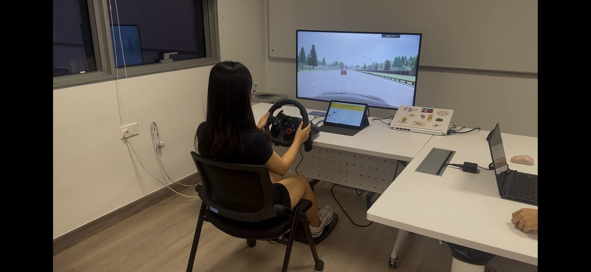
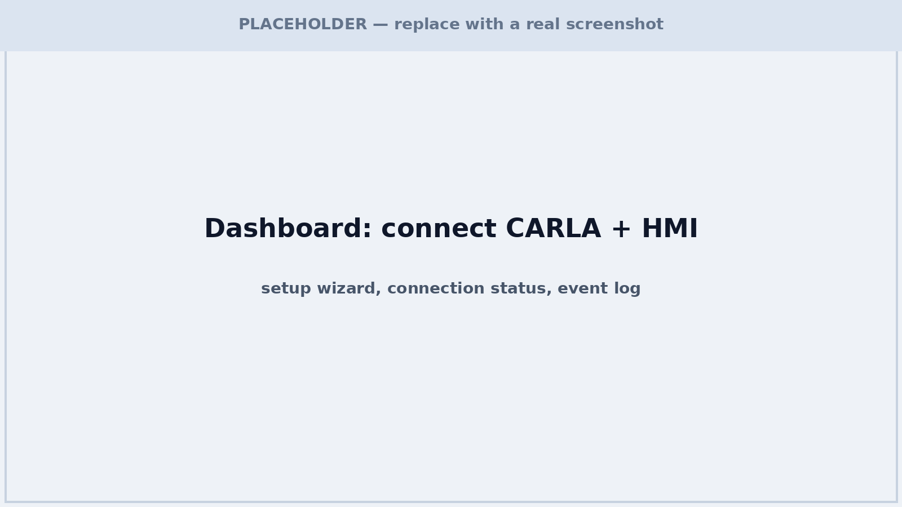
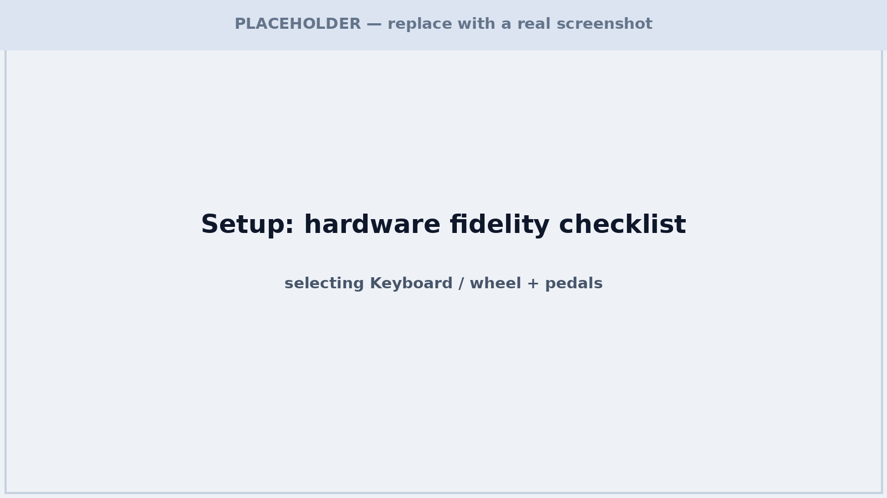
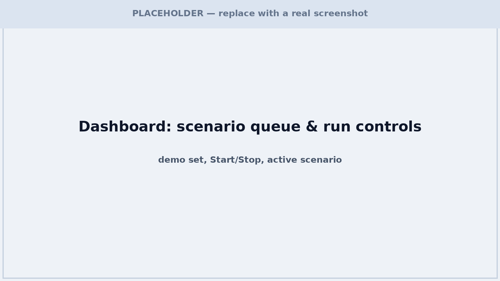
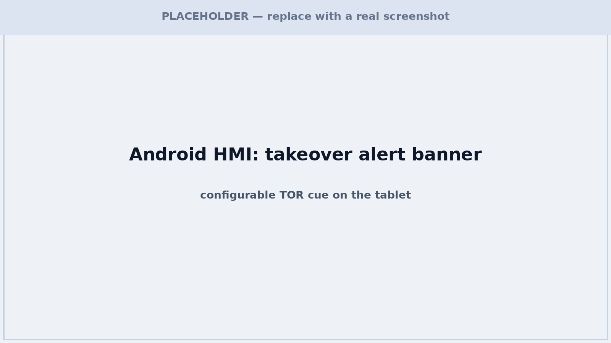
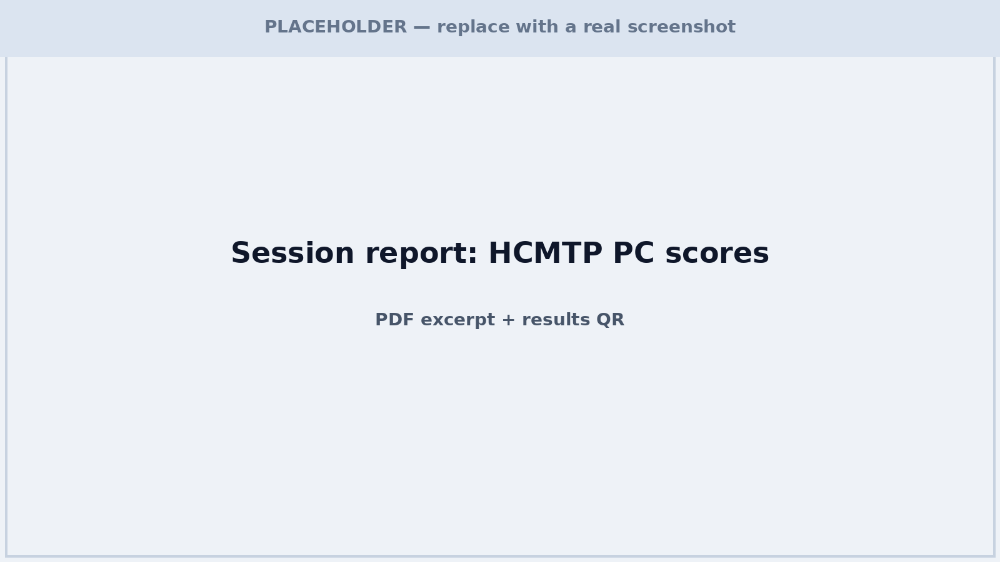

# TakeoverBench




A benchmarking platform for **Takeover Requests (TOR)** in conditionally automated vehicles. TakeoverBench integrates scenario execution, takeover-alert triggering, HMI prototyping, telemetry capture, hardware-fidelity documentation, and automated report generation into a single, reproducible workflow.

```
┌─────────────────────────────────────────────────────┐
│                     TakeoverBench                   │
│                                                     │
│  ┌──────────────┐   HTTP/WS    ┌─────────────────┐  │
│  │    CARLA     │◄────────────►│  Flask Backend  │  │
│  │  Simulator   │  Python API  │  (Dashboard)    │  │
│  └──────────────┘              └────────┬────────┘  │
│                                         │ MQTT      │
│                                ┌────────▼──────────┐│
│                                │   Android HMI     ││
│                                │  (Configurable)   ││
│                                └───────────────────┘│
└─────────────────────────────────────────────────────┘
```

## Key Features

- **Configurable HMI** — Test takeover-alert concepts on an Android tablet without building a new system for each design. Adjust message, colours, position, images, and audio, and prototype rapidly.
- **Predefined Scenario Sets** — Run a complete experiment session with a familiarisation run and multiple experimental takeover conditions. A ready-to-go **Demo set** (Training → Moderate → Hard) is included alongside the full protocol. Load a set, press play, and the system handles the whole flow: loading the map, spawning vehicles, engaging autopilot, auto-triggering the TOR when the TTC threshold is crossed, and logging telemetry.
- **Automated Run Lifecycle** — Each run brakes to a halt at the end, the next scenario is queued automatically, and the evaluator has a **Stop** button as a safety net.
- **Hardware Fidelity Scoring** — Document your physical simulator setup and get a visual, motion, and physical fidelity score on a 1–5 scale based on this [Fidelity Framework](https://doi.org/10.1016/j.ssci.2019.04.004). The platform flags hardware limitations and warns which metrics may not be reliably computable.
- **HCMTP-Aligned Telemetry** — Records 41 objective takeover metrics and reduces them to 9 principal performance dimensions using the [Human-Centred Comprehensive Measure of Take-Over Performance](https://doi.org/10.1109/tits.2022.3233623) framework.
- **PDF Reports & Shareable Results** — Generate a standardised session report (scenario parameters, hardware fidelity, HCMTP scores) with a QR code participants can scan to open their results on a phone.

## Repository Structure

```
takeoverbench/
├── dashboard-server/          # Flask backend + CARLA integration
│   ├── server.py              # Main Flask application
│   ├── sim/                   # Simulation logic (controller, telemetry, HCMTP)
│   ├── static/                # Dashboard frontend (HTML/CSS/JS)
│   ├── templates/             # Jinja2 templates (dashboard, setup, results)
│   ├── scripts/               # Calibration, tunnel and firewall helpers
│   ├── tests/                 # Tests
│   └── pyproject.toml         # Python package configuration
├── hmi-customizer/            # Native Android HMI (Jetpack Compose)
│   ├── app/src/main/
│   │   ├── java/.../          # Kotlin sources (MQTT, screens, UI)
│   │   ├── res/               # Resources (icons, themes, strings)
│   │   │   └── values/strings.xml   # App config (MQTT broker address)
│   └── build.gradle.kts       # Gradle build
├── docs/
│   ├── hcmtp-metrics.md       # HCMTP metric mapping & PCA weights
│   ├── hcmtp-metric-audit.csv # Per-metric code-vs-paper audit
│   └── hcmtp-metric-calculations.md  # Generated: how each metric is computed
└── README.md                  # This file
```

## System Requirements & Installation

TakeoverBench requires a **Windows 10/11** machine capable of running **CARLA 0.9.16**, and an **Android tablet or emulator**. A **Logitech G29** steering wheel and pedals are recommended.

Follow the dedicated setup guides for each component:

1. **[Dashboard Server Setup](./dashboard-server/README.md)**
2. **[HMI Customizer Setup](./hmi-customizer/README.md)**

## Running a Demo Session

> Screenshots below are placeholders. Drop real images into `docs/images/` using the same filenames and they will appear automatically.

1. **CARLA and HMI connection** — Launch CARLA and the HMI app on the tablet. Open the dashboard in a browser, press connect, and both components connect automatically.

   

2. **Configure fidelity** — Select your hardware setup in the setup wizard. For a basic demo without a wheel, choose **Keyboard** (the system will warn about degraded metrics, which is expected).

   

3. **Load and run a scenario** — Load the **Demo set** (or the full protocol), then click Start. The car auto-drives and triggers the takeover request when the TTC threshold is crossed; the participant sees the cue in the CARLA window and on the tablet.

   
   

4. **Review results** — At the end of the set, download the PDF report. The QR code on it opens a mobile-friendly results page for participants.

   

## Acknowledgements

TakeoverBench builds directly on two frameworks, and we gratefully credit their authors:

- **Metrics & HCMTP** courtesy of Li, Q., Wang, Z., Wang, W., Zeng, C., Wu, C., Li, G., Heh, J.-S., & Cheng, B. — *A Human-Centered Comprehensive Measure of Take-Over Performance Based on Multiple Objective Metrics*, IEEE Transactions on Intelligent Transportation Systems, 24(4), 4235–4240. DOI: [10.1109/TITS.2022.3233623](https://doi.org/10.1109/tits.2022.3233623)
- **Hardware fidelity framework** courtesy of Wynne, R. A., Beanland, V., & Salmon, P. M. — *Systematic review of driving simulator validation studies*, Safety Science, 117, 138–151. DOI: [10.1016/j.ssci.2019.04.004](https://doi.org/10.1016/j.ssci.2019.04.004)

## Future Work

- **Tunable timing parameters** — expose TTC threshold, post-TOR drive duration, and other timings in the UI rather than fixed preset values.
- **More scenarios / ASAM OpenSCENARIO** — import standardised scenario definitions instead of hard-coded presets.
- **Multimodal HMI** — extend the HMI beyond visual/auditory cues to tactile feedback via external haptic devices, triggered automatically on takeover.
- **Multi-simulator support** — run equivalent takeover scenarios beyond CARLA while keeping the same HMI, telemetry, fidelity and reporting workflow.
- **NDRT support** — integrate non-driving-related tasks (e.g. a prompted secondary task) so they can be assessed in the workflow.
- **Full-scale baseline calibration** — collect a larger human takeover population per preset to strengthen the standardisation baseline.

## Contributing

This is an academic research project. Contributions, bug reports, and feature requests are welcome. Please open an issue or pull request on [GitHub](https://github.com/singaporetech/takeoverbench). For major changes, please open an issue first to discuss what you would like to change.

## License

This project is currently not licensed for public use. A license will be added prior to open-source release.
